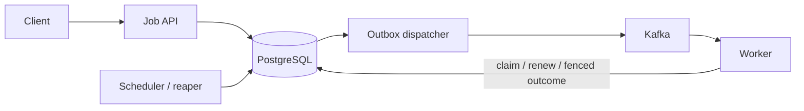

# Distributed Job Execution Platform

A production-style learning project for durable asynchronous jobs, built with Java 21, Spring Boot, PostgreSQL, and Kafka. The implementation focuses on transaction boundaries, ownership, failure recovery, and guarantees that can be defended precisely.

PostgreSQL is the source of truth. Kafka records are at-least-once work-availability signals, never permission to execute. The platform does **not** claim exactly-once handler invocation or exactly-once external side effects.

## What is implemented

- Durable and idempotent job submission with a canonical request fingerprint
- Transactional job/history/outbox creation
- At-least-once Kafka publication with reclaimable dispatcher leases
- PostgreSQL job claims using `FOR UPDATE SKIP LOCKED`
- Lease tokens, monotonic fencing versions, renewal, and stale-owner rejection
- Finite retries with exponential backoff and deterministic jitter
- Worker heartbeats kept separate from ownership authority
- Dead-letter inspection and generation-incrementing operator replay
- Future scheduling, priority ordering, and bounded priority aging
- Cooperative cancellation and database-enforced execution deadlines
- Structured lifecycle logs, correlation IDs, Micrometer metrics, and Prometheus output
- PostgreSQL concurrency tests, Kafka integration tests, and failure-injection experiments

## Architecture



The application is one modular Spring Boot codebase. API, coordinator, dispatcher, and worker behavior can be enabled independently; they are roles, not separate microservice codebases.

## Requirements

- Java 21 or newer
- Docker Desktop
- PowerShell on Windows, or a POSIX shell
- At least 1 GB of free Docker disk space for integration tests

The local runtime uses one PostgreSQL container. Kafka is opt-in through the `messaging` profile. No Kubernetes, Redis, Elasticsearch, or multi-broker Kafka cluster is required.

## Quick start

Start PostgreSQL:

```powershell
.\scripts\start-local.ps1
```

Start PostgreSQL and Kafka:

```powershell
.\scripts\start-local.ps1 -Messaging
```

Run the application in another terminal:

```powershell
.\mvnw.cmd spring-boot:run
```

Run the API demonstration in a third terminal:

```powershell
.\scripts\demo.ps1
```

Stop local infrastructure while retaining the PostgreSQL volume:

```powershell
.\scripts\stop-local.ps1
```

The project intentionally ships no fake production business handler. Enabling the worker without registering a `JobHandler` for the submitted type produces a documented non-retryable failure. Tests register or directly exercise execution behavior at the platform boundary.

## API examples

Submit an immediately eligible job:

```http
POST /jobs HTTP/1.1
Host: localhost:8080
Content-Type: application/json
Idempotency-Key: report-2026-09-20
X-Correlation-Id: demo-report

{
  "type": "GENERATE_REPORT",
  "priority": 5,
  "payload": {"report": "daily"},
  "executionTimeoutSeconds": 30
}
```

Submitting the same body with the same idempotency key returns the original job. Reusing the key with execution-relevant changes returns `409 Conflict`.

Schedule a job:

```json
{
  "type": "GENERATE_REPORT",
  "priority": 25,
  "payload": {"report": "monthly"},
  "runAt": "2030-01-01T00:00:00Z"
}
```

Cancel it before execution:

```http
POST /jobs/{jobId}/cancel
Content-Type: application/json

{"requestedBy":"demo-operator","reason":"demonstrating pending cancellation"}
```

Operator endpoints:

- `GET /jobs/{jobId}` and `GET /jobs`
- `GET /operator/dead-letter-jobs` and `GET /operator/dead-letter-jobs/{jobId}`
- `POST /operator/dead-letter-jobs/{jobId}/replay`
- `GET /operator/workers`
- `GET /actuator/health`, `/actuator/metrics`, and `/actuator/prometheus`

## Runtime roles

Role switches are environment variables; all default to off except the API:

```powershell
$env:OUTBOX_DISPATCHER_ENABLED = 'true'
$env:SCHEDULING_MAINTENANCE_ENABLED = 'true'
$env:RETRY_MAINTENANCE_ENABLED = 'true'
$env:WORKER_ENABLED = 'true'
$env:WORKER_ID = 'worker-local-1'
.\mvnw.cmd spring-boot:run
```

Use the worker role only when the application contains a `JobHandler` bean for the submitted job type.

## Tests

```powershell
.\mvnw.cmd verify
```

The current suite contains 64 test methods. The final Phase 12 run recorded 64 passed, 0 failed, 0 errors, and 0 skipped. Tests include real PostgreSQL races through Testcontainers and one embedded single-node KRaft Kafka publication test. This is a correctness suite, not a throughput benchmark; no latency or throughput numbers are claimed.

## Guarantees in one paragraph

An accepted dispatchable job, its history, and its outbox record commit atomically. Duplicate messages and concurrent claims cannot create two valid database owners. Every owner write proves job generation, owner, random lease token, monotonic lease version, and database-time validity. Expired, cancelled, timed-out, or replaced owners cannot mutate authoritative state. Recovery can repeat handler invocation and external effects, so downstream idempotency or fencing is still required.

## Repository map

- `src/main/java/.../job`: submission, state machine, cancellation, dead-letter operations
- `src/main/java/.../outbox`: durable event storage and Kafka dispatcher
- `src/main/java/.../lease`: claim, renewal, completion, and failure fencing
- `src/main/java/.../worker`: signal consumption, execution, identity, and heartbeat
- `src/main/java/.../retry`: backoff, lease recovery, and retry promotion
- `src/main/java/.../scheduler`: future scheduling and priority aging
- `src/main/java/.../observability`: correlation and lifecycle metrics
- `src/main/resources/db/migration`: Flyway schema history
- `src/test/java`: integration, concurrency, and failure-injection tests

## Resource use and cleanup

Kafka is ephemeral in Compose and retains local messages for only 24 hours. PostgreSQL uses the named `distributed_job_exec_platform_job-platform-postgres` volume. `docker compose down` preserves it; `docker compose down -v` deletes it and should be used only when its data is intentionally disposable.

Inspect Docker usage with `docker system df -v`. Prefer `docker builder prune` for rebuildable cache; do not indiscriminately prune named volumes.
